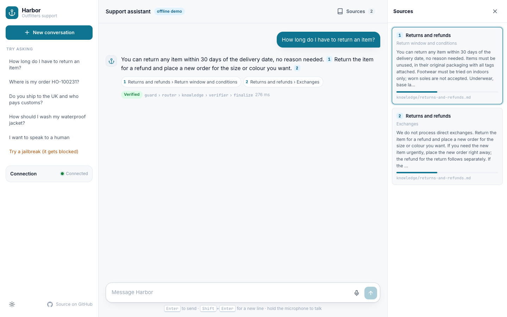
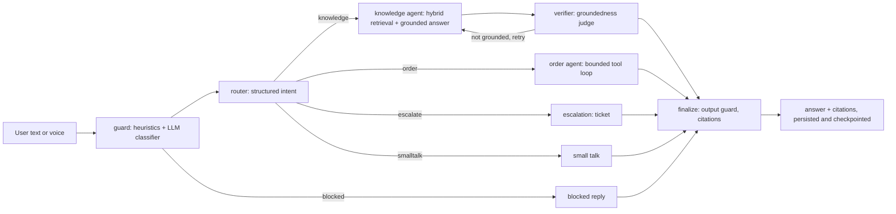

# Harbor

Production-grade customer support assistant for an online store, built end to end.




- **RAG** with hybrid retrieval: pgvector (dense, HNSW) + Postgres full-text search, fused with Reciprocal Rank Fusion, then reranked (Voyage rerank-2.5, or an LLM reranker). Pinecone is a drop-in alternative index.
- **Multi-agent workflow** on LangGraph: guard, router, knowledge agent, order agent (tool use), escalation agent, small talk, and a groundedness verifier that sends weak drafts back for a rewrite. Conversation memory is checkpointed in Postgres per thread.
- **LLM**: Claude (Opus 5.5 for answers, Haiku 4.5 for classification and reranking, Sonnet 5.5 for verification) via `langchain-anthropic` with structured outputs.
- **Voice**: push-to-talk in the browser, speech to text and text to speech through ElevenLabs or OpenAI; the voice turn runs the same graph as text.
- **Prompt-injection defence** in five layers: heuristic scoring, LLM classifier, document quarantine at ingestion, spotlighting of untrusted content, output guard (secret redaction, citation validation, prompt canary).
- **Evaluation**: golden set with routing accuracy, retrieval hit rate and MRR, LLM-as-judge rubric, Ragas (faithfulness, answer relevancy, context precision and recall) and an injection red-team suite. Runs in CI in offline mode.
- **Operations**: FastAPI with API keys, rate limiting, request ids, structured logs, health and readiness probes, Alembic migrations, Docker image, docker compose, GitHub Actions.

## How a turn flows



Retrieval inside the knowledge agent: query embedding -> pgvector HNSW (or Pinecone) and Postgres full-text search in
parallel -> Reciprocal Rank Fusion -> reranker (Voyage rerank-2.5 or Claude Haiku) -> relevance gate -> spotlighted
`<document>` blocks with ids the model must cite.

## Hosted demo page

The chat page is live at https://harbor-support.netlify.app. Netlify serves the static front end; the API runs on a
container host you point the page at (Backend URL box). `deploy/HOSTING.md` lists a fully free hosting combination
(Hugging Face Spaces or Render for the API, Neon or Supabase for Postgres with pgvector, Groq for the LLM).

## Run it for free, no paid keys

```bash
pip install -e ".[free]"            # fastembed (local embeddings + cross-encoder reranker) and the OpenAI-compatible client
# LLM: any OpenAI-compatible endpoint. Free options: Groq, Gemini (OpenAI endpoint), OpenRouter :free models,
# or Ollama on your machine with no key at all (ollama pull qwen2.5:3b).
EMBEDDING_DIM=384 EMBEDDINGS_PROVIDER=local RERANKER=local LLM_PROVIDER=openai_compatible \
OPENAI_COMPAT_BASE_URL=http://localhost:11434/v1 OPENAI_COMPAT_API_KEY=ollama \
make db migrate seed ingest serve
```

Verified on 25 Nov 2026 with Ollama `qwen2.5:3b`, `BAAI/bge-small-en-v1.5` embeddings and the
`Xenova/ms-marco-MiniLM-L-6-v2` reranker on a 2019 Intel laptop: a policy question ran guard, router, hybrid
retrieval, draft, verifier retry and citation validation end to end (about 2 minutes per turn on that CPU; a hosted
free LLM such as Groq answers in seconds).

## Quick start (no keys, no database)

```bash
make install
make demo            # http://127.0.0.1:8000  (API key: dev-key)
.venv/bin/harbor chat --offline
```

Offline mode swaps Claude for a deterministic scripted model and the vector index for an in-memory one. Every code path (graph, guard, streaming, voice endpoint, evals) is the production one; only the providers are fakes.

## Full stack

```bash
cp .env.example .env     # add ANTHROPIC_API_KEY and VOYAGE_API_KEY (plus ELEVENLABS_API_KEY for voice)
make db migrate seed ingest
make serve
```

Or `docker compose up --build` to run the API and Postgres together.

```bash
curl -s localhost:8000/v1/chat -H 'x-api-key: dev-key' -H 'content-type: application/json' \
  -d '{"message": "How long do I have to return an item?"}' | jq
```

## Layout

```
harbor/
  api/          FastAPI app, middleware (auth, rate limit, request id), routes (chat, stream, voice, ingest, conversations)
  agents/       LangGraph state, nodes, graph, runtime, tools, structured output schemas, model factory, scripted fake model
  retrieval/    embeddings providers, vector index adapters (pgvector, Pinecone), RRF fusion, rerankers, hybrid retriever
  ingest/       loader, heading-aware chunker with breadcrumbs, idempotent pipeline with injection quarantine
  guard/        injection heuristics, spotlighting, output guard (secrets, citations, canary)
  voice/        ElevenLabs / OpenAI speech providers
  evals/        golden set, attack set, metrics, LLM judge, Ragas adapter, runner
  db/           SQLAlchemy models, repositories (hybrid search SQL), engine
  prompts/      versioned system prompts
alembic/        migrations (pgvector extension, HNSW + GIN indexes)
knowledge/      sample policy documents for the fictional Harbor Outfitters store
seeds/          sample customers and orders
tests/          unit (offline) and integration (Postgres) suites
```

## Verified state

Unit suite (27 tests, offline) and integration suite (3 tests, real Postgres with pgvector) pass locally and in
GitHub Actions. The Docker image boots against the compose database and serves answers. Offline eval on the bundled
golden set: routing accuracy 1.0, retrieval hit@3 0.93, judge pass rate 1.0, red team block rate 11/11 with 0 benign
false positives. The scripted offline model proves the plumbing, not answer quality: run `make eval` with real keys for
quality numbers.

## Tests and evals

```bash
make test                 # unit suite, offline, a few seconds
make db test-integration  # real Postgres: migrations, ingestion, hybrid SQL, checkpoints
make eval-offline         # golden set + red team with the scripted model
make eval                 # full run with Claude, Voyage and Ragas; reports in evals/reports/<timestamp>/
```

## API

| Method | Path | Auth | Purpose |
|---|---|---|---|
| POST | /v1/chat | key | one turn, JSON |
| POST | /v1/chat/stream | key | one turn, server-sent events (status, token, rewrite, done) |
| POST | /v1/voice/chat | key | multipart audio in, transcript + answer + audio out |
| GET | /v1/conversations/{id} | key | transcript |
| POST | /v1/ingest/knowledge | admin | (re)ingest bundled knowledge |
| POST | /v1/ingest/upload | admin | ingest uploaded markdown/text |
| POST | /v1/ingest/reindex | admin | push all vectors to the external index |
| GET | /healthz, /readyz | none | probes |

## Providers

| Role | Options (env) | Free choice |
|---|---|---|
| LLM | `LLM_PROVIDER=anthropic` (Claude Opus 5.5 / Sonnet 5.5 / Haiku 4.5), `openai_compatible` (Groq, Gemini, OpenRouter, Ollama, vLLM), `fake` | Groq free tier or Ollama |
| Embeddings | `EMBEDDINGS_PROVIDER=voyage`, `openai`, `local` (fastembed bge-small, 384 dims), `fake` | local |
| Reranker | `RERANKER=voyage` (rerank-2.5), `local` (MiniLM cross-encoder), `llm`, `none` | local |
| Vector index | `VECTOR_BACKEND=pgvector`, `pinecone` | pgvector |
| Speech | `SPEECH_PROVIDER=elevenlabs`, `openai`, `fake` | ElevenLabs free tier |

## Documentation

`docs/Harbor_Technical_Deep_Dive.docx` explains every design decision, the alternatives that were rejected, the database integration and the evaluation method, written as interview deep-dive material. Sources and build script in `docs/deep-dive/`.
